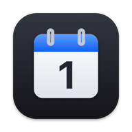
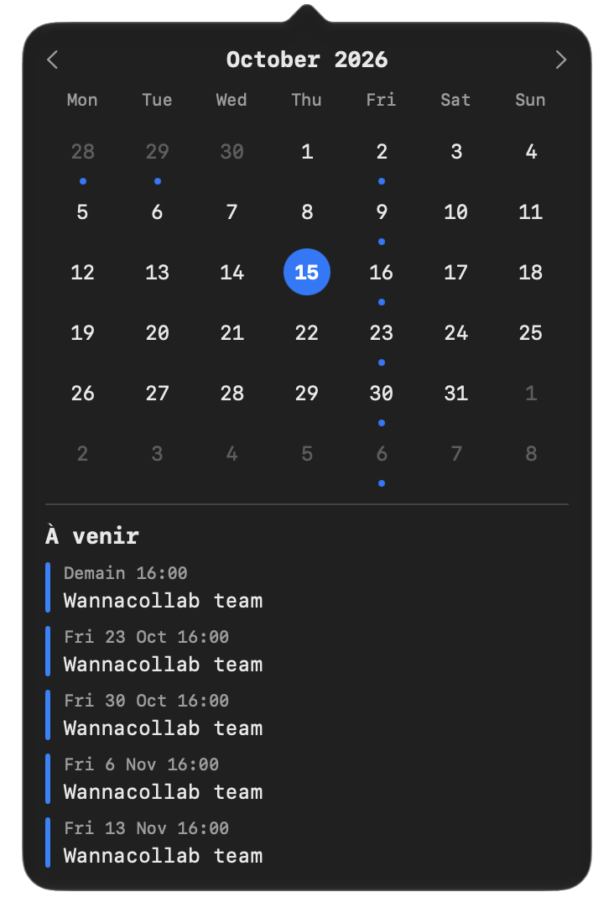
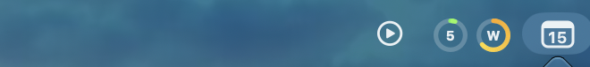

# Jour

App macOS de barre de menus : une icône calendrier avec le numéro du jour, et
au clic un popover avec le mois (point sous les jours occupés) et les cinq
prochains événements, tirés de tes agendas Google via leurs flux iCal.
Apparence native macOS (couleur d'accentuation, clair/sombre).





## Installation

1. Télécharge **Jour-x.y.zip** depuis la
   [dernière release](https://github.com/lmaix/jour/releases/latest).
2. Dézippe-le et glisse **Jour.app** dans ton dossier
   **Applications**.

L'app est signée et notariée : elle se lance sans avertissement de Gatekeeper.

### Compiler depuis les sources

```bash
./build.sh
```

Compile, lance les tests, installe `~/Applications/Jour.app`, la
démarre et l'inscrit au lancement à l'ouverture de session. Aucune dépendance
en dehors de Xcode (ou des Command Line Tools, `xcode-select --install`).
`release.sh` produit le zip universel signé et notarié publié dans les
releases.

## Ajouter un agenda

1. Google Agenda (web) → Paramètres → dans la colonne de gauche, l'agenda →
   section « Intégrer l'agenda » → **Adresse secrète au format iCal** → copier.
2. Clic droit sur l'icône → **Ajouter un agenda iCal…** → colle l'URL, choisis
   un nom (facultatif) et une couleur.

Répète pour chaque agenda (perso, pro…). Les URL sont des secrets : elles
donnent accès en lecture à l'agenda et sont stockées dans ton Trousseau.
Toute autre URL `.ics` / `webcal://` fonctionne aussi.

## Utilisation

- Clic gauche : le calendrier. ‹ › changent de mois, clic sur le titre revient
  à aujourd'hui.
- Sous la grille : **À venir**, les 5 prochains événements (en cours ou futurs)
  avec « Aujourd'hui », « Demain » ou la date. Clic sur un jour : ses
  événements ; « À venir » ou re-clic pour revenir.
- Clic droit : liste des agendas (Retirer), Ajouter, Actualiser, Quitter.

## Limites

- Google met le flux iCal en cache : une modification peut mettre de quelques
  minutes à quelques heures à apparaître. Rafraîchissement toutes les 5 min,
  à l'ouverture du popover (30 s min) et au changement de mois.
- Récurrences développées par l'app : quotidien, hebdo (BYDAY), mensuel
  (jour du mois, nième jour de semaine), annuel, INTERVAL, COUNT, UNTIL,
  EXDATE et occurrences modifiées (RECURRENCE-ID). Les règles exotiques
  (BYSETPOS, BYWEEKNO…) ne sont pas gérées.
- Événements annulés ignorés ; ceux que tu as déclinés aussi, quand l'URL
  Google contient ton adresse (cas des agendas principaux).
